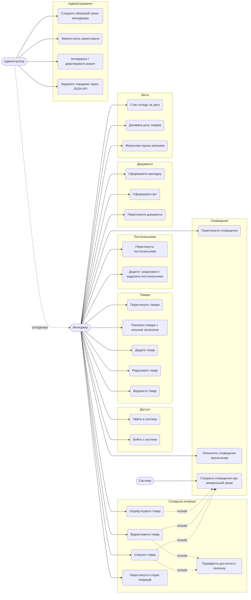
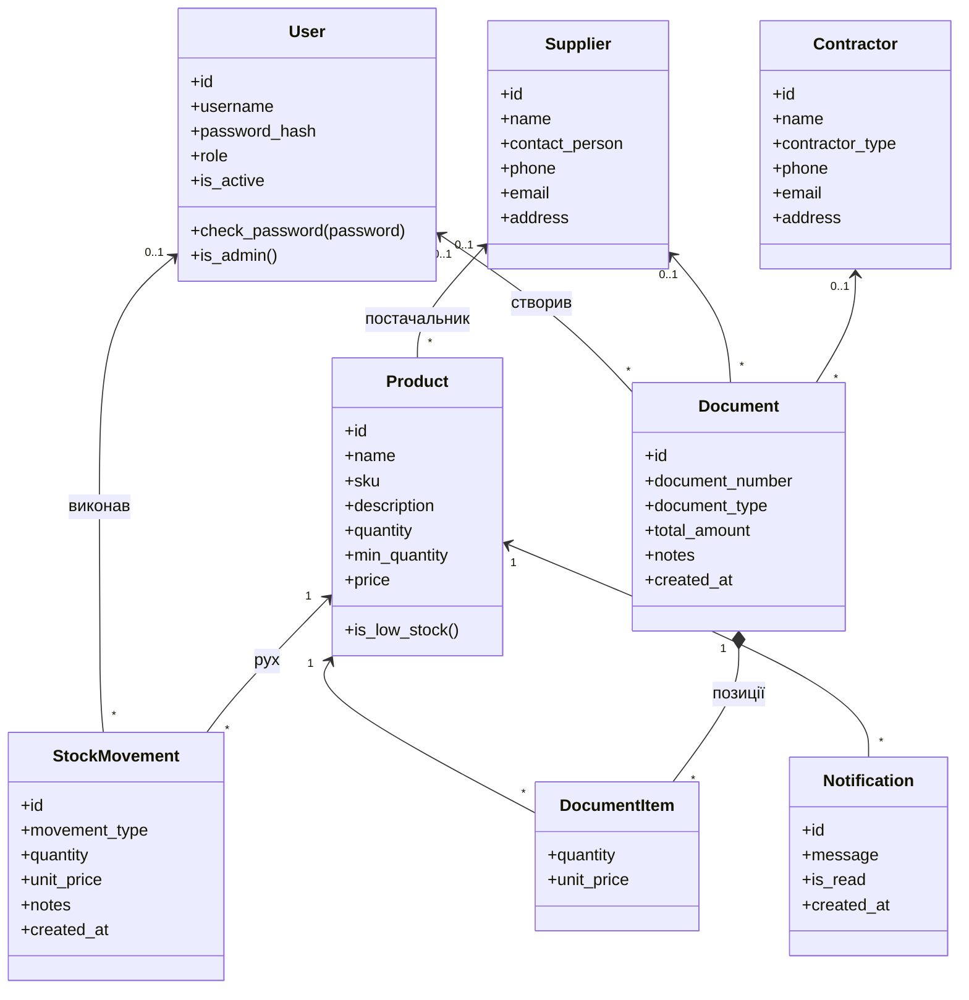
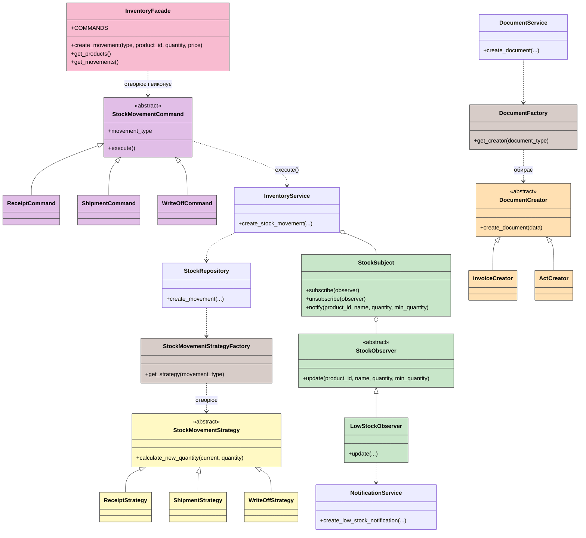
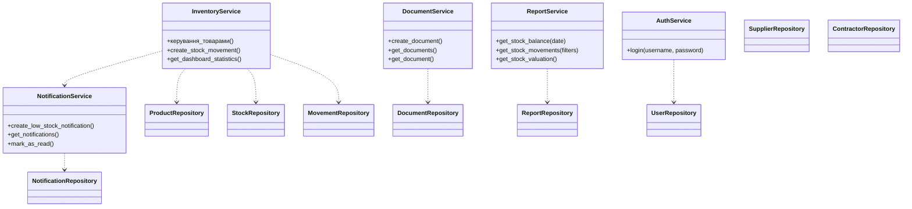
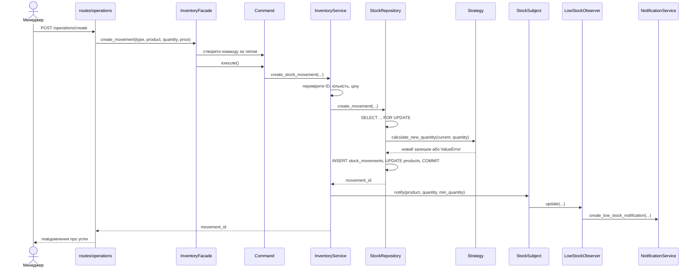
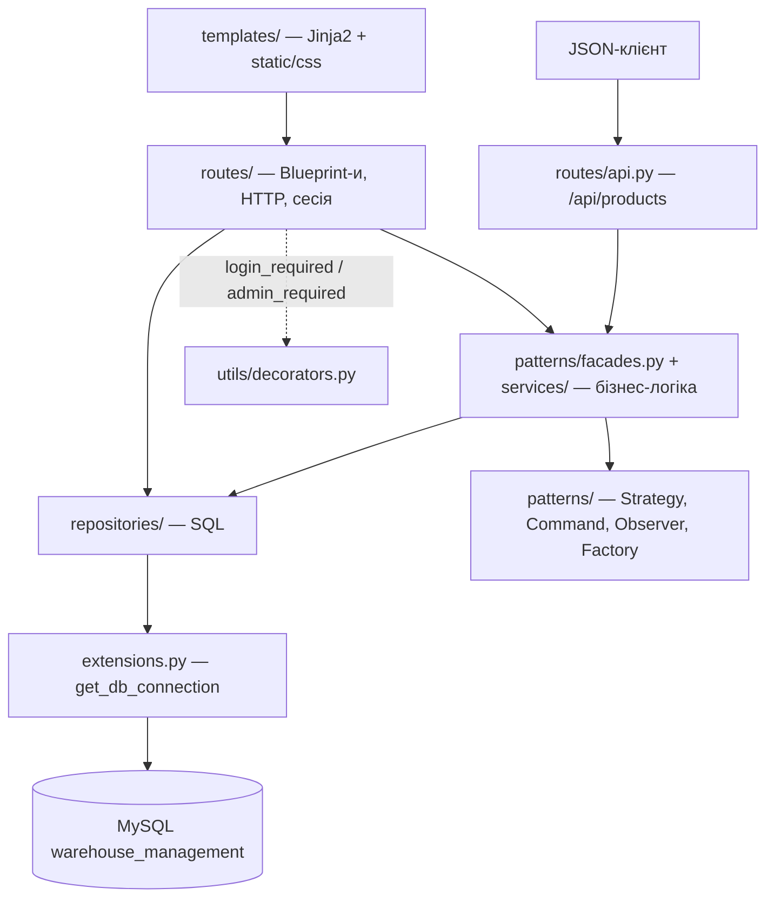
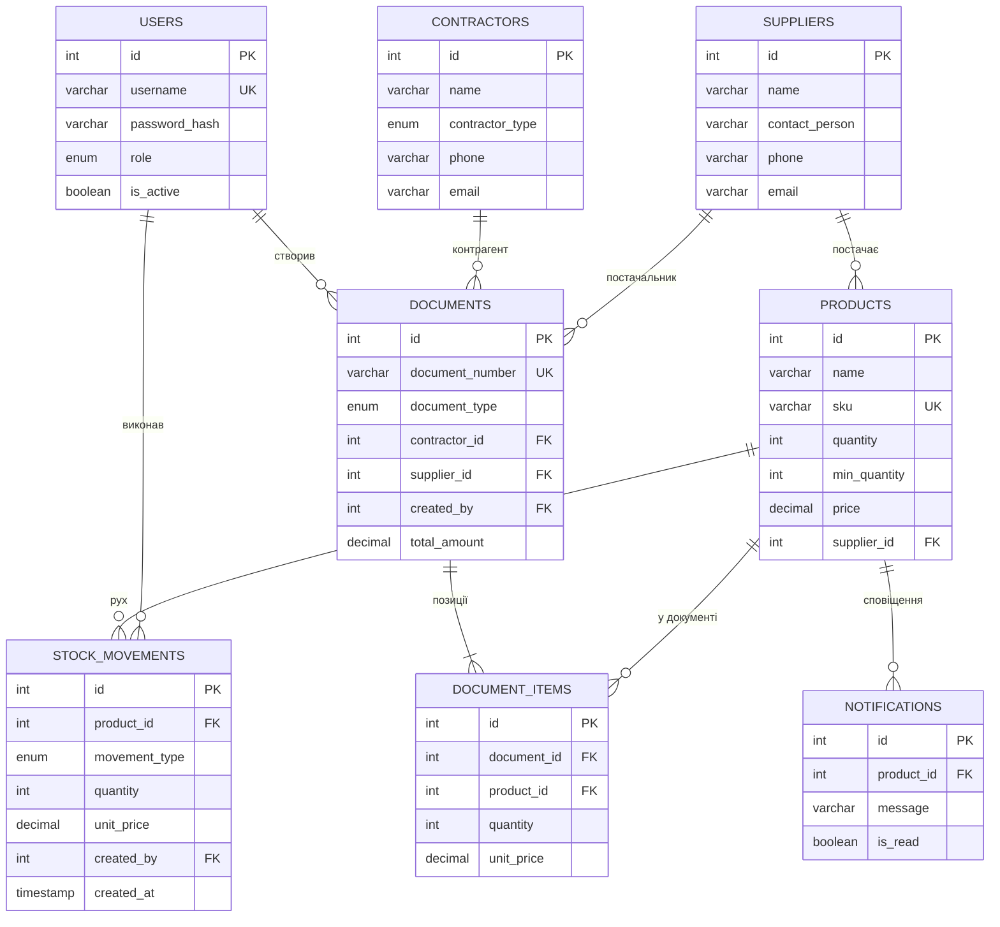

# СкладPro — аналіз та проєктування

Система складського обліку (варіант 2): реєстрація товарів, облік руху (надходження, відвантаження, списання), контроль залишків, автоматичні сповіщення про мінімальний запас, накладні й акти, облік постачальників і контрагентів, звіти.

**Стек:** Python 3, Flask 3 (Blueprint-и), Jinja2, MySQL (`mysql-connector-python`), Werkzeug (хешування паролів), pytest.

## 1. Предметна область і Use Case

**Актори:**
- **Менеджер** (`manager`) — щоденна робота зі складом.
- **Адміністратор** (`admin`) — усе, що вміє менеджер, плюс керування користувачами та доступ до JSON API на запис.
- **Система** — внутрішній актор: автоматично створює сповіщення про низький залишок.

**Пояснення:**
- Адміністратор успадковує всі сценарії менеджера; додатково має сторінку `/admin` і право створювати, змінювати й видаляти товари через `/api/products`.
- Відвантаження та списання *включають* перевірку достатності залишку (`UC14`): якщо товару менше, ніж потрібно, операція відхиляється.
- Після кожної операції система перевіряє залишок і за потреби створює сповіщення (`UC23`). Так само це відбувається після створення й редагування товару.
- Накладна й акт зберігаються разом із позиціями та сумою; залишки змінюються лише складськими операціями.
- Самостійної реєстрації немає: облікові записи менеджерів створює адміністратор.

## 2. Діаграма класів

Діаграму розбито на три частини: (2.1) сутності, (2.2) GoF-патерни, (2.3) шари застосунку. Разом вони описують систему в цілому.

### 2.1 Сутності предметної області

Сутності реалізовані класами в `app/models/` (з `from_dict` / `to_dict`) і таблицями MySQL у `database/schema.sql`.

### 2.2 GoF-патерни (кольорами позначено патерни)

| Колір | Патерн |
|---|---|
| жовтий | Strategy |
| фіолетовий | Command |
| рожевий | Facade |
| помаранчевий | Factory Method |
| коричневий | Simple Factory |
| зелений | Observer |

### 2.3 Шари застосунку

Маршрути (`app/routes/*`) викликають сервіси, фасад або репозиторії; доступ до MySQL є лише в репозиторіях (`app/repositories/*`).

| Компонент | Використовує |
|---|---|
| `InventoryService` | `ProductRepository`, `StockRepository`, `MovementRepository`, `NotificationService`, `StockSubject` |
| `DocumentService` | `DocumentRepository`, `DocumentFactory`, модель `Document` |
| `ReportService` | `ReportRepository`, `StockMovement.VALID_TYPES` |
| `NotificationService` | `NotificationRepository` |
| `AuthService` | `UserRepository`, `User.check_password` |
| Маршрути `suppliers`, `admin` | напряму `SupplierRepository`, `UserRepository` |
| Маршрути `documents` | `DocumentService` + довідники через `ProductRepository`, `SupplierRepository`, `ContractorRepository` |
| Маршрут `operations` | `InventoryFacade` |

## 3. GoF-шаблони

| Шаблон | Де застосовано | Навіщо |
|---|---|---|
| **Strategy** | `StockMovementStrategy` → `ReceiptStrategy`, `ShipmentStrategy`, `WriteOffStrategy` (`patterns/strategies.py`) | кожен тип операції має власне правило розрахунку нового залишку та перевірки (відвантажити більше, ніж є, не можна); новий тип додається окремим класом |
| **Simple Factory** | `StockMovementStrategyFactory.get_strategy`, `DocumentFactory.get_creator` | вибір стратегії чи фабрики документа за рядком із форми або БД в одному місці |
| **Command** | `StockMovementCommand` → `ReceiptCommand`, `ShipmentCommand`, `WriteOffCommand` (`patterns/commands.py`) | операція інкапсульована як об'єкт зі своїми параметрами (товар, кількість, ціна, автор) і методом `execute()` |
| **Facade** | `InventoryFacade` (`patterns/facades.py`) | єдина точка входу для складських операцій: маршрут не знає ні про команди, ні про сервіс |
| **Factory Method** | `DocumentCreator` → `InvoiceCreator`, `ActCreator` (`patterns/factories.py`) | кожен тип документа (накладна, акт) створюється власним творцем, який виставляє `document_type` |
| **Observer** | `StockSubject`, `StockObserver`, `LowStockObserver` (`patterns/observers.py`) | сервіс залишків не залежить від сповіщень: після зміни він лише повідомляє підписників, а `LowStockObserver` створює сповіщення, коли `quantity <= min_quantity` |
| **Repository** | пакет `app/repositories/` | уся робота з MySQL ізольована в одному шарі |

**Як шаблони працюють разом (складська операція):**
`InventoryFacade` обирає команду за типом → `Command.execute()` викликає `InventoryService` → `StockRepository` в одній транзакції бере `Strategy` від `StockMovementStrategyFactory`, перераховує залишок і записує рух → `InventoryService` передає новий залишок у `StockSubject` → `LowStockObserver` через `NotificationService` створює сповіщення.

**Як шаблони працюють разом (документ):**
`DocumentService` перевіряє позиції та рахує суму → `DocumentFactory` обирає `InvoiceCreator` або `ActCreator` → творець виставляє тип документа → `DocumentRepository` зберігає документ і позиції в одній транзакції.

## 4. Архітектура

Серверний веб-застосунок за шаблоном MVC із шаровою структурою: **Jinja2-шаблони** → **Flask-маршрути (Blueprint)** → **фасад і сервіси** → **репозиторії** → **MySQL**.

| Шар | Файли | Відповідальність |
|---|---|---|
| Presentation | `routes/*`, `templates/*`, `static/css` | сторінки, форми, JSON API, перевірка сесії та ролі |
| Application | `services/*`, `patterns/facades.py`, `patterns/commands.py` | сценарії: товари, операції, документи, звіти, сповіщення, вхід |
| Domain | `models/*`, `patterns/strategies.py`, `patterns/observers.py`, `patterns/factories.py` | сутності та правила (розрахунок залишку, типи документів, умова сповіщення) |
| Infrastructure | `repositories/*`, `extensions.py`, `config.py`, `database/*.sql` | SQL, транзакції, підключення до MySQL, налаштування з `.env` |

**Безпека й доступ**
- Автентифікація через сесію Flask; паролі зберігаються як хеші (`werkzeug.security`).
- `login_required` захищає сторінки; `admin_required` захищає `/admin/*`.
- JSON API повертає `401` без входу та `403` для менеджера на запис.
- Самореєстрація вимкнена (`/auth/register` → 403); акаунти створює адміністратор.
- Адміністратор не може змінити власну роль, деактивувати себе чи позбавити прав останнього адміністратора.

**Цілісність даних**
- Операція на складі виконується в одній транзакції з блокуванням рядка товару (`SELECT ... FOR UPDATE`), тому паралельні відвантаження не можуть «піти в мінус».
- У БД діють `CHECK`-обмеження (`quantity >= 0`, `price >= 0`, `quantity > 0` для операцій і позицій), унікальність `sku` та `document_number`.

### GRASP
- **Controller** — Blueprint-маршрути приймають запит і делегують сервісам.
- **Information Expert** — `StockMovementStrategy` знає, як змінюється залишок; `Product.is_low_stock` знає про поріг; `Document` перевіряє власний тип.
- **Low Coupling** — `InventoryService` не залежить від способу сповіщення: лише від інтерфейсу `StockObserver`.
- **High Cohesion** — окремі сервіси й репозиторії для товарів, документів, звітів, сповіщень.
- **Polymorphism** — типи операцій (Strategy, Command) і типи документів (Factory Method).
- **Pure Fabrication** — репозиторії, фабрики й `InventoryFacade` не відповідають об'єктам предметної області.
- **Indirection** — `InventoryFacade` відокремлює маршрути від команд і сервісу.
- **Protected Variations** — новий тип операції додається класами стратегії та команди та реєструється в словниках `_strategies` і `COMMANDS`.

### SOLID
- **S** — кожен клас має одну причину для змін: маршрут (HTTP), сервіс (сценарій), репозиторій (SQL), стратегія (одне правило).
- **O** — нові стратегії, команди, творці документів і спостерігачі додаються розширенням, без зміни існуючих класів.
- **L** — усі стратегії, команди й спостерігачі взаємозамінні через спільні абстракції.
- **I** — вузькі інтерфейси: `calculate_new_quantity`, `execute`, `create_document`, `update`.
- **D** — `InventoryFacade`, `DocumentService`, `NotificationService`, `ReportService` приймають залежність через конструктор (є значення за замовчуванням); `LowStockObserver` залежить від сервісу сповіщень, а не від БД.

## 5. Маршрути та REST API

### JSON API (`/api`)

| Метод | URL | Доступ | Призначення | Коди |
|---|---|---|---|---|
| GET | `/api/products` | увійшов | список товарів | 200, 401 |
| GET | `/api/products/{id}` | увійшов | один товар | 200, 401, 404 |
| POST | `/api/products` | admin | створити товар | 201, 400, 401, 403 |
| PATCH | `/api/products/{id}` | admin | змінити окремі поля | 200, 400, 401, 403, 404 |
| DELETE | `/api/products/{id}` | admin | видалити товар | 204, 401, 403, 404, 409 |

### Веб-інтерфейс

| Розділ | URL | Призначення |
|---|---|---|
| Вхід | `/auth/login`, `/auth/logout` (POST) | вхід та вихід |
| Головна | `/home` | кількість товарів, загальний залишок, товари з низьким запасом |
| Товари | `/products/`, `/products/?low_stock=1`, `/products/create`, `/products/{id}`, `/products/{id}/edit`, `/products/{id}/delete` | облік і контроль залишків |
| Постачальники | `/suppliers/`, `/suppliers/create`, `/suppliers/{id}`, `/suppliers/{id}/edit`, `/suppliers/{id}/delete` | облік постачальників |
| Операції | `/operations/`, `/operations/create`, `/operations/{id}` | надходження, відвантаження, списання |
| Документи | `/documents/`, `/documents/create`, `/documents/{id}` | накладні та акти |
| Звіти | `/reports/stock-balance`, `/reports/stock-movements`, `/reports/stock-valuation` | стан складу на дату, динаміка руху, фінансова оцінка |
| Сповіщення | `/notifications/`, `/notifications/{id}/read` (POST) | перегляд і позначення прочитаним |
| Адміністрування | `/admin/`, `/admin/users`, `/admin/users/{id}/toggle-active` (POST) | користувачі, ролі, активність |

### Звіти

| Звіт | Як розраховується |
|---|---|
| Стан складу на дату | поточний залишок мінус рухи після кінця вибраної дати; вартість = ціна × залишок на дату |
| Динаміка руху | операції за період із фільтрами за товаром і типом |
| Фінансова оцінка залишків | сума «ціна × поточний залишок» по всіх товарах |

## 6. База даних

| Таблиця | Обмеження та поведінка |
|---|---|
| `products` | `sku` унікальний; `CHECK` на `quantity`, `min_quantity`, `price` ≥ 0; при видаленні постачальника `supplier_id` стає `NULL` |
| `stock_movements` | `movement_type` ∈ {`receipt`, `shipment`, `write_off`}; `quantity > 0`; товар видалити не можна, поки є історія руху |
| `documents` | `document_number` унікальний; `document_type` ∈ {`invoice`, `act`}; зв'язки з контрагентом, постачальником і автором очищаються (`SET NULL`) |
| `document_items` | видаляються разом із документом (`CASCADE`); `quantity > 0` |
| `notifications` | видаляються разом із товаром (`CASCADE`) |
| Індекси | `stock_movements(created_at)`, `stock_movements(product_id, created_at)`, `documents(created_at)` — для звітів |

## 7. Тестування

Тести в `tests/` (pytest):

| Файл | Що перевіряє |
|---|---|
| `test_inventory.py` | стратегії: надходження збільшує, відвантаження й списання зменшують залишок, відхилення недостатнього залишку та нульової кількості; вибір стратегії фабрикою |
| `test_products.py` | валідація й нормалізація даних товару, дублікат артикула, залишок не змінюється при редагуванні |
| `test_reports.py` | розрахунок залишків на дату, фільтри руху, оцінка запасів |
| `test_api.py` | доступ до API: `401` без входу, `403` для менеджера на запис, `400` для некоректного JSON, `404` |
